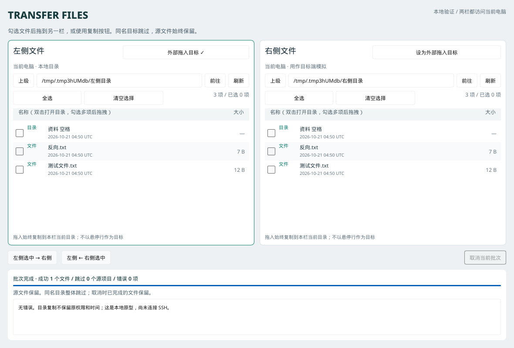

# Transfer Files

Rust + Slint 双栏文件管理原型，为后续“公司 Linux → 公网 SSH 跳板机 → 家里 Windows”的两段传输客户端验证交互。

**当前两栏都操作运行程序的电脑上的真实本地文件。尚未接入 SSH、密码认证或远端 Windows；“远程设置”目前只保存连接参数。**



截图由 Linux 无窗口软件渲染测试生成，展示本地双向复制完成后的界面；不是龙芯实机截图。

## 功能

- 双栏目录浏览，路径输入、上级、刷新；目录优先、名称排序，显示大小与 UTC 修改时间。
- 勾选多项、全选、清空选择；双击目录进入。
- 从一栏拖到另一栏复制；也可使用中间的双向复制按钮。
- 从 Dolphin 拖入文件、多个文件、目录，作为一个批次复制。
- 后台扫描及复制、字节进度、错误日志、取消。
- 同名目标跳过，源文件保留；目录同名整体跳过，不合并。
- “远程设置”窗口可保存跳板机与 Windows 的连接参数；密码不会保存。

## 在龙芯 Linux 上运行

已由用户验证的基础环境：Loongnix 25、LoongArch64、glibc 2.41、X11、Rust/Cargo 1.95.0。此前已通过 Slint 最小窗口验证；本仓库完整原型仍需要在目标电脑验收。

依赖固定 Slint 1.18.1，使用 Winit + 软件渲染，避免依赖 Skia 预编译包或 GPU 渲染。

在 KDE 桌面的 Konsole 里，进入项目目录：

```bash
cargo run --locked
```

这是开发运行方式。首次验证完成后，可以构建一次 Release 版本，之后直接启动编译好的程序：

```bash
cargo build --release --locked
./target/release/transfer-files
```

也可以使用仓库提供的一键启动脚本。脚本只在 Release 程序不存在时构建，后续启动直接运行程序，不需要每次重新编译：

```bash
bash scripts/run.sh
```

如果希望从 KDE 应用菜单启动，可以把 `scripts/run.sh` 添加为桌面快捷方式；脚本所在的项目目录需要保留不变。源代码更新后重新执行一次 `cargo build --release --locked` 即可。

启动后点击右上角“远程设置”，填写跳板机地址、端口、用户名，以及家里 Windows 的 Tailscale 地址、SSH 端口、用户名和默认目录。当前版本只保存这些参数并显示保存位置，不会发起连接；密码也不会写入磁盘。Linux 默认保存到 `~/.config/transfer-files/config.conf`。

两栏默认打开当前目录。可指定不同的初始目录，路径含空格时加引号：

```bash
cargo run --locked -- "$HOME/Downloads" "$HOME/Documents"
```

明确选择 X11（本应用的原生外部拖入适配针对 X11）：

```bash
WINIT_UNIX_BACKEND=x11 cargo run --locked
```

首次构建会下载 Rust 依赖。系统 C/C++ 编译工具已在用户电脑确认可用。若构建或启动提示缺少系统库，Loongnix 的 Debian 风格仓库可参考以下包名；以目标仓库实际可用包为准：

```bash
sudo apt install build-essential pkg-config libfontconfig1-dev libxkbcommon-dev libx11-dev libxcb1-dev
```

## 操作方式

1. 左栏打开源目录，右栏打开另一个已有目录。
2. 勾选源文件，拖动其中一个已勾选的文件行到另一栏的文件列表；选中的项目将一并复制。
3. 拖动未勾选的文件行时，仅复制该项目。
4. 右栏到左栏同样操作。也可以使用“左侧选中 → 右侧”等按钮。
5. 从 Dolphin 拖到本应用任意一栏：X11 通过落下时的窗口内坐标确定目标栏。落到栏内时，目标始终为该栏**当前目录**，不会进入悬停的子目录。
6. 若平台不提供 X11 坐标查询，则使用标注“外部拖入目标”的栏；可先点击“设为外部拖入目标”。Wayland 和其他平台的原生拖入行为未验收。
7. 复制时可以继续浏览；任务目标在发起时固定，不会随导航变化。原型同一时间只执行一批，新拖入不会追加到正在运行的批次。

原型尚不支持从 GUI 拖出到 Dolphin。内部拖拽使用应用内数据，不向外部伪装为已下载的远程文件。

## 测试目录与人工验收

可以使用脚本创建隔离的示例目录，然后按输出的命令运行：

```bash
bash scripts/create-demo.sh
```

按 [原型验收清单](docs/prototype-validation.md) 验证，尤其是 Dolphin 多文件拖入、中文输入与取消。

## 开发检查

```bash
cargo fmt --check
cargo clippy --locked --all-targets -- -D warnings
cargo test --locked
```

测试覆盖递归复制、中文路径、空目录、零字节文件、同名跳过、目标并发出现、取消清理，以及 Slint 无窗口环境中的真实鼠标拖拽和双向复制。测试还会生成界面截图到 `target/qa/`，不进入 Git。

## 复制边界

- 不覆盖任何同名目标；同名目录不做增量合并。
- 不复制符号链接及特殊文件；不复制到源目录自身或其子目录。
- 不保留源文件权限、所有者或时间戳。
- 文件先写入目标目录中的 `.transfer-files-*.part`，完成后通过硬链接无覆盖发布；目标文件系统必须支持硬链接，例如通常的 ext4、Btrfs、NTFS。FAT/exFAT 等不支持的目标会报告错误。
- 取消时清理当前未完成文件，已完成的文件保留。正常错误路径会尝试移除空的任务目录；强制杀进程或断电可能留下 `.part`，本地原型尚未做重启恢复。
- 校验大小与修改时间，防止明显的源文件变化；没有内容级校验和，也不能保证源文件被并发修改时的一致快照。
- 目录读取及复制运行于后台线程；取消会在文件块读写之间检查，操作系统 I/O 阻塞时不会瞬间结束。

## 目录结构

```text
src/main.rs                     界面控制、目录工作线程、拖放适配、批次进度
src/config.rs                   远程连接参数的加载、校验和保存（不含密码）
src/files.rs                    本地目录读取与可取消的复制引擎
ui/app.slint                    双栏界面
docs/development-requirements.md 完整需求与后续 SSH 方案
docs/prototype-validation.md    目标机验收与当前验证记录
scripts/create-demo.sh          创建本地人工测试目录
scripts/run.sh                  构建（必要时）并启动 Release 程序
```

Slint 资料：[渲染后端](https://docs.slint.dev/latest/docs/slint/guide/backends-and-renderers/backends_and_renderers/)、[拖放接口](https://docs.slint.dev/latest/docs/slint/reference/drag-and-drop/dragarea/)。
